# Week 2 - Footprinting, Reconnaissance & Network Scanning

**Cybersecurity & Ethical Hacking Internship · Networkwalks**
**Author:** Muhammad Abdal Khan (Batch B084)  |  **Date:** 12 November 2026  |  **Full report:** [`Week2_Pentest_Report.pdf`](Week2_Pentest_Report.pdf)

> All activity was done within an authorised scope: the Networkwalks target, passive public sources, and my own lab network. See the [disclaimer](#disclaimer).

---

## Overview

This repository documents my Week 2 project work covering **Phase 1 (Reconnaissance & Footprinting)** and **Phase 2 (Scanning & Network Discovery)** of a penetration test. Every task below includes the command I ran, what it returned, a screenshot as evidence, and why it matters from an attacker's and a defender's point of view.

| Module | Topic | Type | Status |
|---|---|---|---|
| **PM1** | Footprinting with six Kali tools (`whois`, `whatweb`, `nslookup`, `curl`, `wafw00f`, `dnsrecon`) | Elective | ✅ Done |
| **PM2** | Footprinting with GHDB (Google dorks) | Elective | ✅ Done |
| **PM4** | Footprinting with theHarvester | Elective | ✅ Done |
| **PM5** | Network scanning with Zenmap | Essential | ✅ Done |
| **PM-FINAL** | Penetration testing report | Essential | ✅ [PDF](Week2_Pentest_Report.pdf) |

## Contents

- [PM1 - Footprinting with multiple Kali tools](#pm1--footprinting-with-multiple-kali-tools)
- [PM2 - GHDB / Google dorking](#pm2--ghdb--google-dorking)
- [PM4 - theHarvester](#pm4--theharvester)
- [PM5 - Network scanning with Zenmap](#pm5--network-scanning-with-zenmap)
- [Risk summary](#risk-summary)
- [Recommendations](#recommendations)
- [Repository structure](#repository-structure)
- [Disclaimer](#disclaimer)

---

## PM1 - Footprinting with multiple Kali tools

**Target:** `networkwalks.com` (authorised training target) · **Run on:** Kali Linux · **Date:** 11 Nov 2026

| # | Tool | Command | Key finding |
|---|---|---|---|
| 1 | whois | `whois networkwalks.com` | Registrar **GoDaddy.com, LLC**; created 2019-11-06, expires 2027-11-06; name servers on **HostGator**; DNSSEC **unsigned**; registrant hidden behind Domains By Proxy |
| 2 | whatweb | `whatweb networkwalks.com` | **Apache**, **WordPress 7.1.4**, **WP Download Manager 3.3.76**, jQuery 3.7.1, Google Tag Manager; server IP and `info@` address leaked |
| 3 | nslookup | `nslookup networkwalks.com` | Resolves to **192.232.216.135** (non-authoritative answer) |
| 4 | curl | `curl -i networkwalks.com` | `301` redirect to HTTPS issued by *Really Simple Security*; reveals Apache, an nginx/Endurance cache layer and a `__wpdm_client` cookie |
| 5 | wafw00f | `wafw00f networkwalks.com` | Site is behind **ModSecurity (SpiderLabs)** WAF |
| 6 | dnsrecon | `dnsrecon -d networkwalks.com` | SOA/NS on HostGator, **BIND 9.16.23-RH** banner exposed, MX `mail.networkwalks.com`, SPF record (`~all`), 8 cPanel autodiscover SRV records |

**1 · whois - registry data and registrar data**

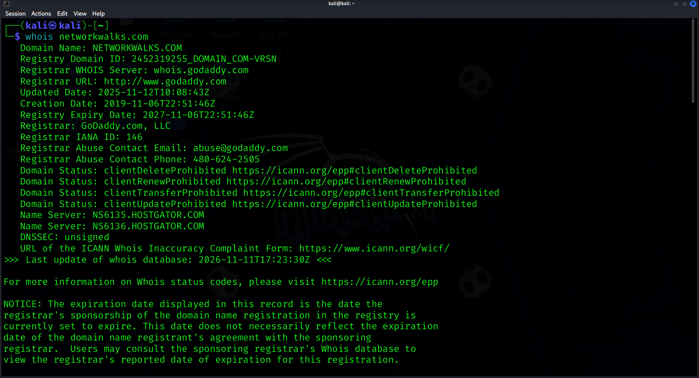
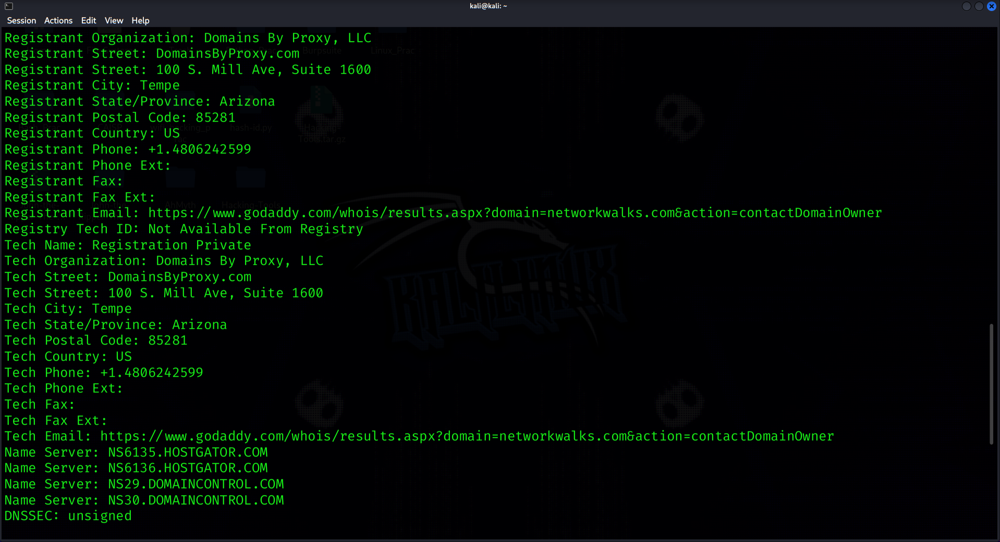

**2 · whatweb - technology fingerprint**

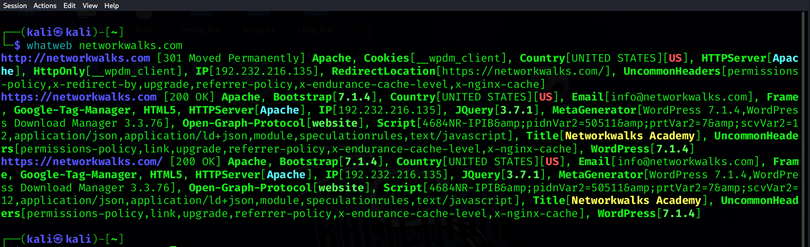

**3 · nslookup - DNS resolution**

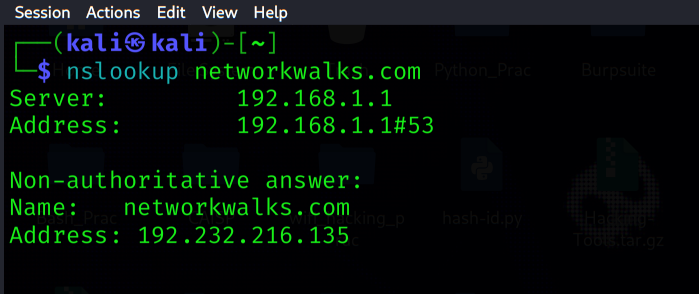

**4 · curl - HTTP response headers**

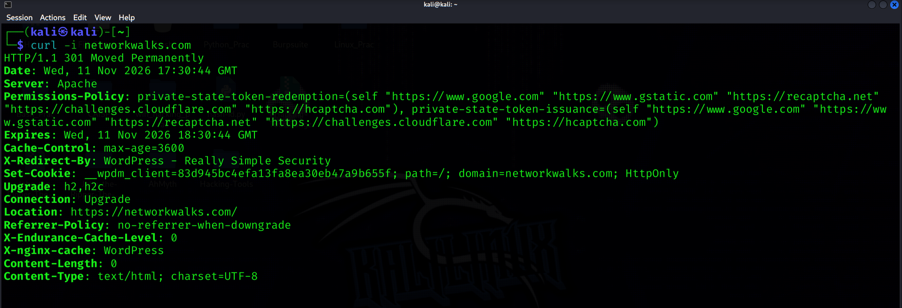

**5 · wafw00f - WAF detection**

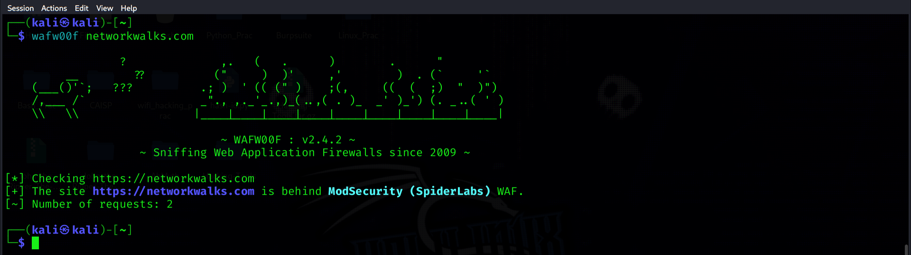

**6 · dnsrecon - DNS enumeration**

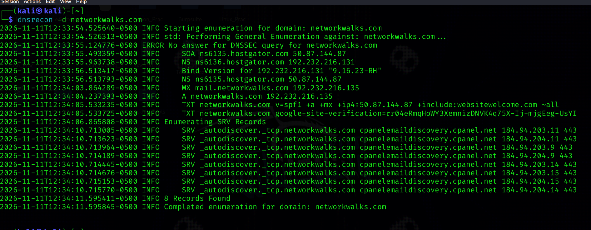

> Raw text output of all six tools: [`evidence/pm1-raw-tool-output.txt`](evidence/pm1-raw-tool-output.txt)

---

## PM2 - GHDB / Google dorking

**Method:** Searched the Exploit-DB Google Hacking Database for dorks, ran them in Google (plus public camera indexes such as Insecam), and recorded the results. This is **passive recon** - I only viewed publicly indexed pages and did not log in, change settings or interact with any device.

> **Privacy note:** the last octet of raw IP addresses is masked below (`xxx`) because these are third-party devices.

### Task 1 - Ten publicly exposed camera links

| # | Link | Dork used | Credentials |
|---|---|---|---|
| 1 | `http://109.233.191.xxx:8080` | `intitle:"webcamXP" inurl:8080` | None |
| 2 | `http://109.206.96.xxx:8080` | `intitle:"webcamXP" inurl:8080` | None |
| 3 | `http://109.233.191.xxx:8080/multi.html` | `intitle:"webcamXP" inurl:8080` | None |
| 4 | `http://72.199.200.xxx:8080/` | `intitle:"webcamXP" inurl:8080` | None |
| 5 | `http://75.149.26.xxx:1024/` | `intitle:"webcamXP" inurl:8080` | None |
| 6 | https://www.lmc.edu/webcam.htm | `intitle:"Webcam" inurl:WebCam.htm` | None |
| 7 | `http://99.114.240.xxx:8080/` | `intitle:"Webcam" inurl:WebCam.htm` | None |
| 8 | https://www.towson.edu/campus/landmarks/webcam.html | `intitle:"Webcam" inurl:WebCam.htm` | None |
| 9 | http://www.insecam.org/en/view/986159/ | `inurl:mobile.html intitle:webcamXP` | None |
| 10 | https://www.webcamxp.com/screenshots.aspx | `inurl:mobile.html intitle:webcamXP` | None |

### Task 2 - Ten listings with downloadable mathematics PDFs

| # | Link | Dork used |
|---|---|---|
| 1 | https://justmathbg.info/files/ | `intitle: index of "parent directory" mathematics.pdf` |
| 2 | https://netlib.org/math/docpdf/ | `intitle: index of "parent directory" mathematics.pdf` |
| 3 | https://mathflix.luc.edu/pdfs/Algebra/ | `intitle: index of "parent directory" mathematics.pdf` |
| 4 | https://www.jsoftware.com/books/pdf/ | `intitle: index of "parent directory" mathematics.pdf` |
| 5 | https://math-olymp.rudn.ru/doc/ | `intitle: index of "parent directory" mathematics.pdf` |
| 6 | https://archive.org/details/cnx-org-col10615 | `intitle: 'mathematics.pdf'` |
| 7 | https://batch.libretexts.org/print/Letter/Finished/math-48772/Full.pdf | `intitle: 'mathematics.pdf'` |
| 8 | https://www.cambridge.org/core/books/abs/number-theory-and-polynomials/index-of-authors/0D7CE8B68FEC86CBBCA2B70768C7CF26 | `intitle:"index of" "mathematics" filetype:pdf` |
| 9 | https://match.pmf.kg.ac.rs/electronic_versions/Match79/n2/match79n2_467-475.pdf | `intitle:"index of" "mathematics" filetype:pdf` |
| 10 | https://webhomes.maths.ed.ac.uk/~v1ranick/papers/as4.pdf | `intitle:"index of" "mathematics" filetype:pdf` |

**Takeaway:** a few well-chosen search operators are enough to surface exposed devices and open directories without ever touching the target. Several of the camera links (university and vendor pages) are *intentionally* public; the unauthenticated `webcamXP` streams are the ones owners most likely did not mean to expose.

---

## PM4 - theHarvester

**Target:** `microsoft.com` (public OSINT only) · **Tool:** theHarvester 4.11.1 · **Date:** 11 Nov 2026

| Task | Command | Result |
|---|---|---|
| 1 | `theHarvester -d microsoft.com -b baidu -l 1000` | **Nothing returned**: no IPs, emails, people or hosts from Baidu |
| 2 | `theHarvester -d microsoft.com -b all -l 50` | **137 IPs**, **3 emails**, **9,481 host entries**, 0 LinkedIn links, 0 people |

Emails found (all role/service mailboxes, not individuals): `dotnet-docker-bot@microsoft.com`, `opencode@microsoft.com`, `secure@microsoft.com`.

**Task 1 - Baidu source**

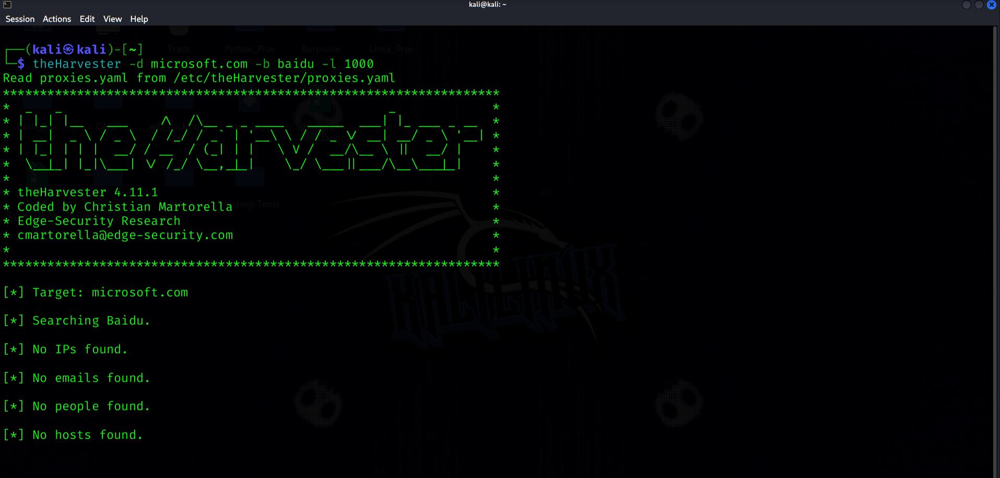

**Task 2 - all sources**

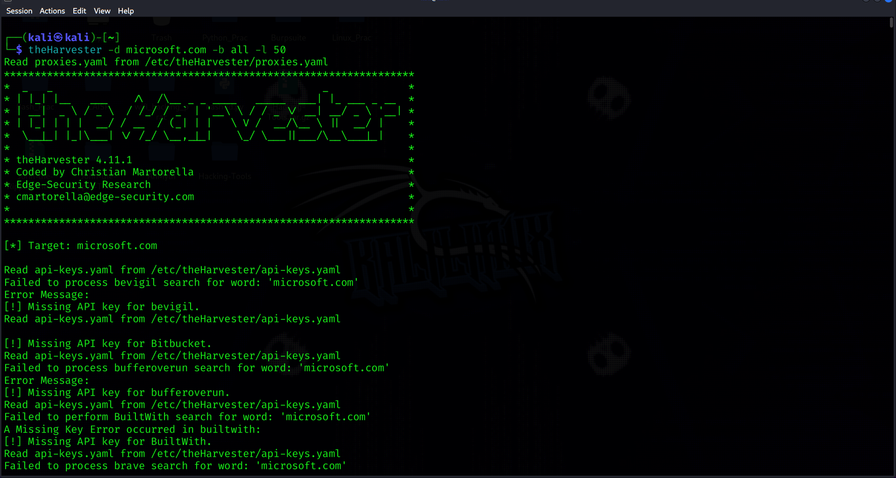
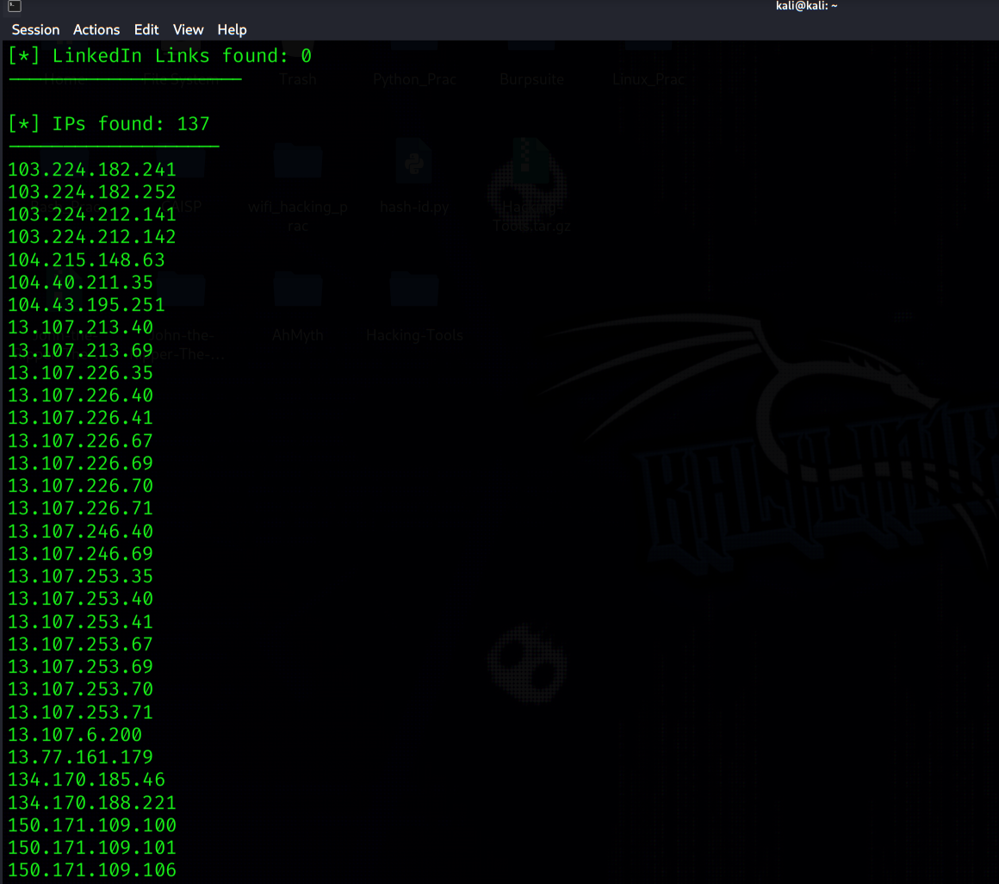
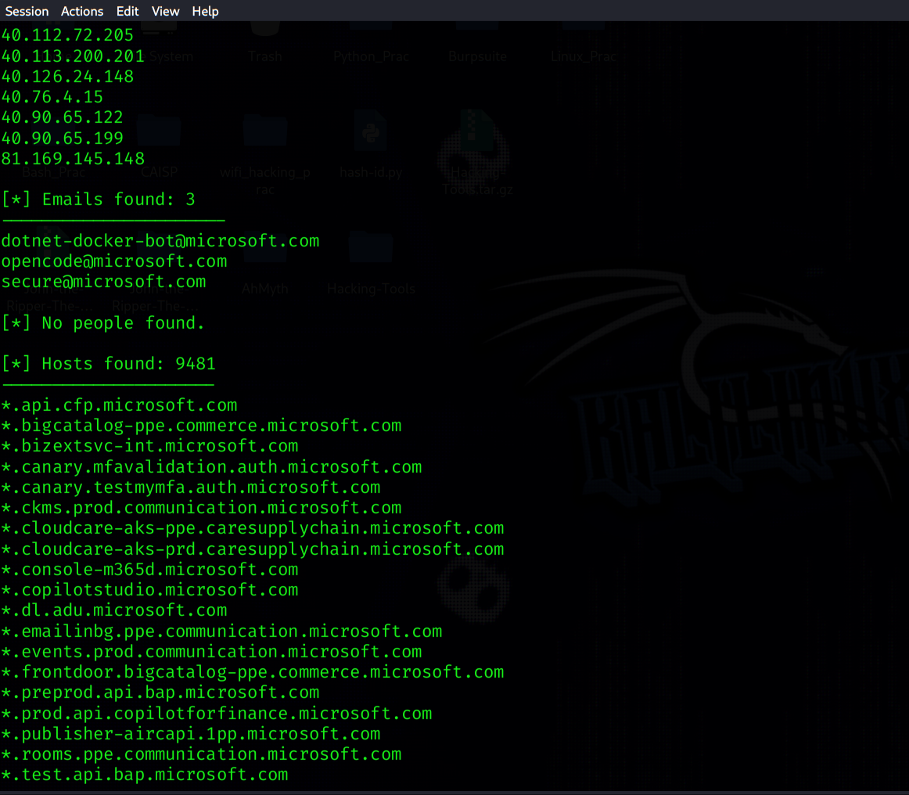
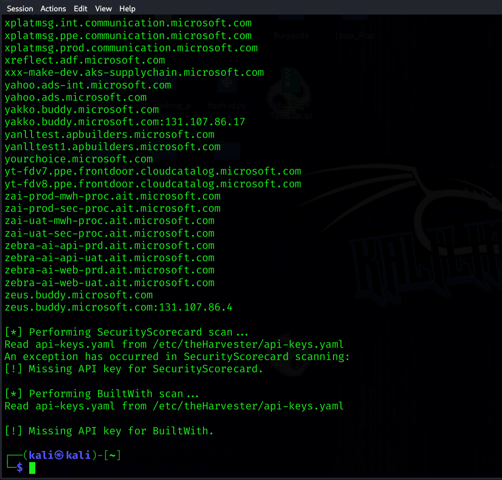

**Observations**

- Several sources (BeVigil, Bitbucket, BufferOver, BuiltWith, Brave, SecurityScorecard) failed with *Missing API key*, so this run used only the key-less sources. Adding API keys would widen the results.
- Host names such as `*.ppe.*`, `*-uat-*`, `*-int-*` and `test.*` hint at pre-production environments, which are often less hardened than production.
- The `-l 50` limit did not cap the totals shown, so it appears not every source module enforces it.

---

## PM5 - Network scanning with Zenmap

**Environment:** Windows PC lab · Nmap/Zenmap 7.993 · **Date:** 12 Nov 2026

| Task | What I did | Result |
|---|---|---|
| 1 | Downloaded and installed Zenmap from nmap.org | `nmap-7.993-setup` installed to `C:\Program Files (x86)\Nmap` |
| 2 | Found local IP and subnet with `ipconfig` | **10.0.0.10**, mask 255.255.255.0 → subnet **10.0.0.0/24**, gateway 10.0.0.1 |
| 3 | Ping scan (`nmap -sn 10.0.0.0/24`) | 256 addresses scanned in 133.69 s |
| 4 | Live hosts | **4 hosts up** (including my PC) |
| 5 | IP addresses | `10.0.0.1`, `10.0.0.2`, `10.0.0.3`, `10.0.0.10` |
| 6 | MAC addresses | see table below |
| 7 | Topology saved as PDF | [`evidence/pm5-zenmap-topology.pdf`](evidence/pm5-zenmap-topology.pdf) |

| Host | MAC address | Vendor (per Nmap) |
|---|---|---|
| 10.0.0.1 | `52:54:00:12:35:00` | QEMU virtual NIC |
| 10.0.0.2 | `08:00:27:8A:E5:07` | Oracle VirtualBox virtual NIC |
| 10.0.0.3 | `52:54:00:12:35:00` | QEMU virtual NIC |
| 10.0.0.10 | *Not shown by Nmap (local host)* - `ipconfig /all` is needed | - |

**Task 1 - install**

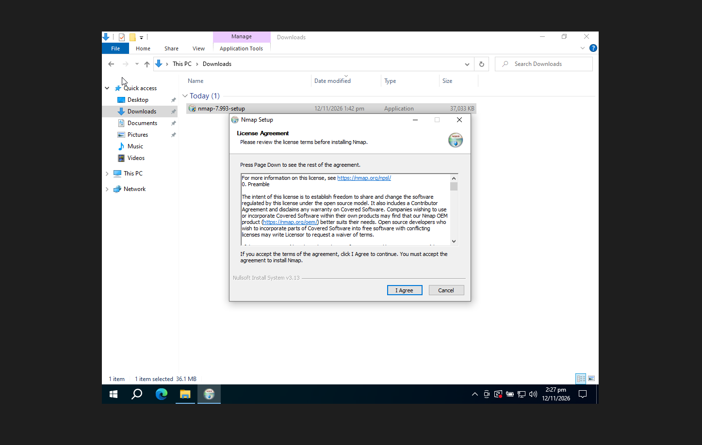
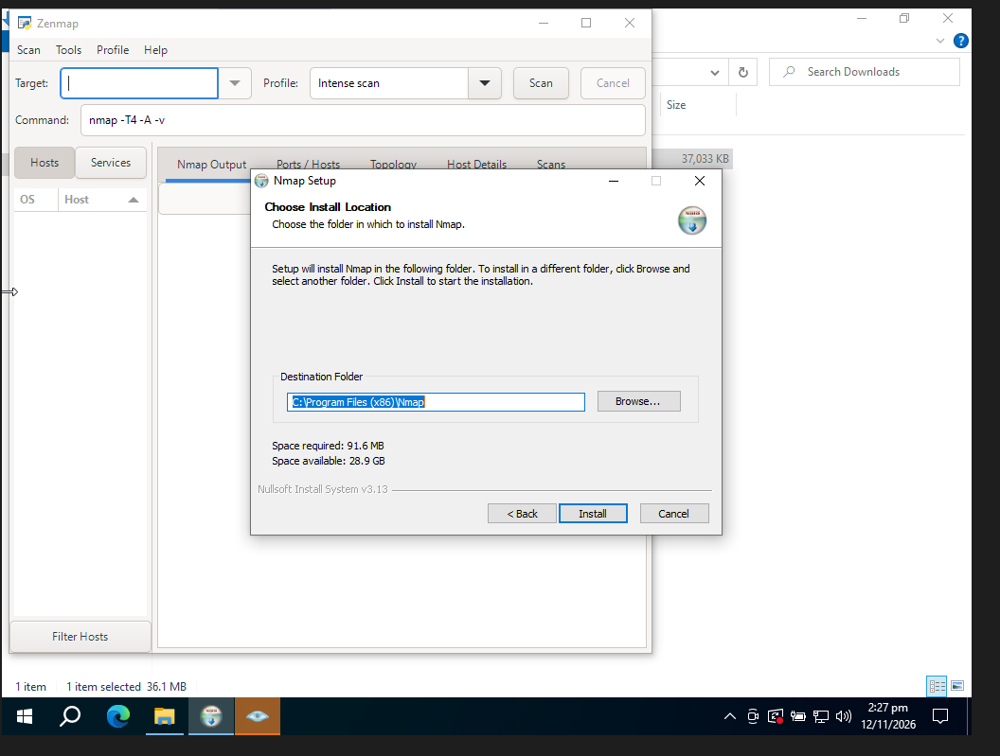

**Task 2 - local IP and subnet**

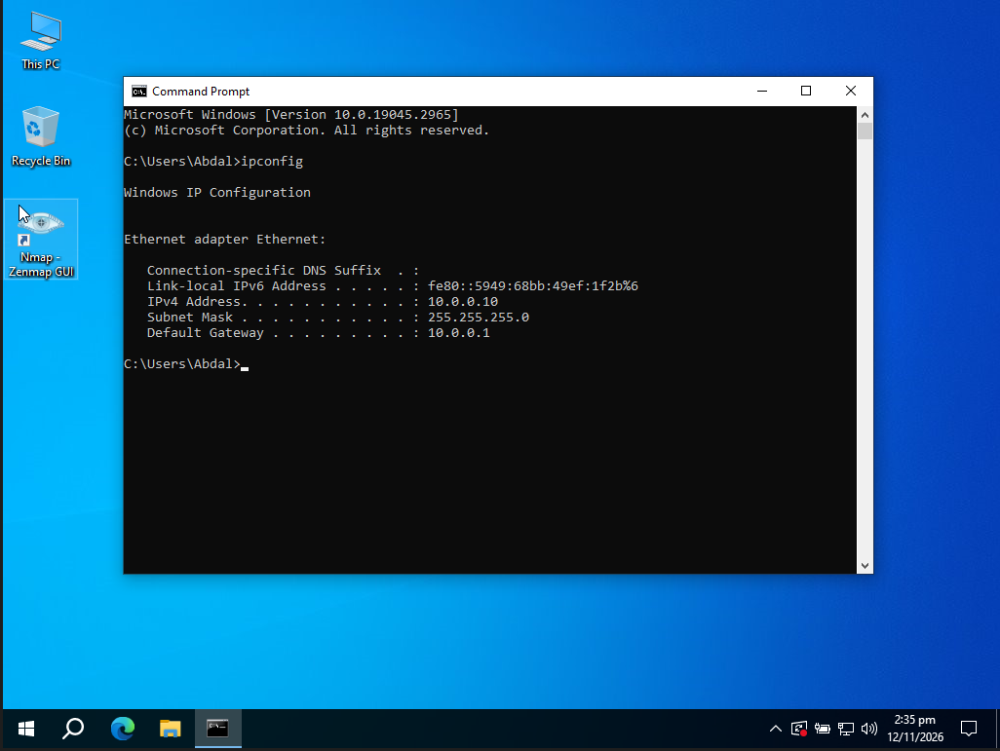

**Tasks 3–6 - ping scan, live hosts, IPs, MACs**

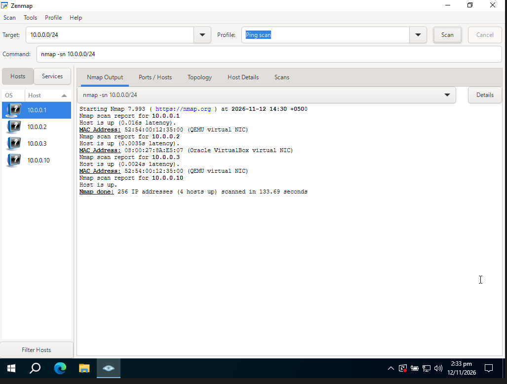

**Task 7 - topology**

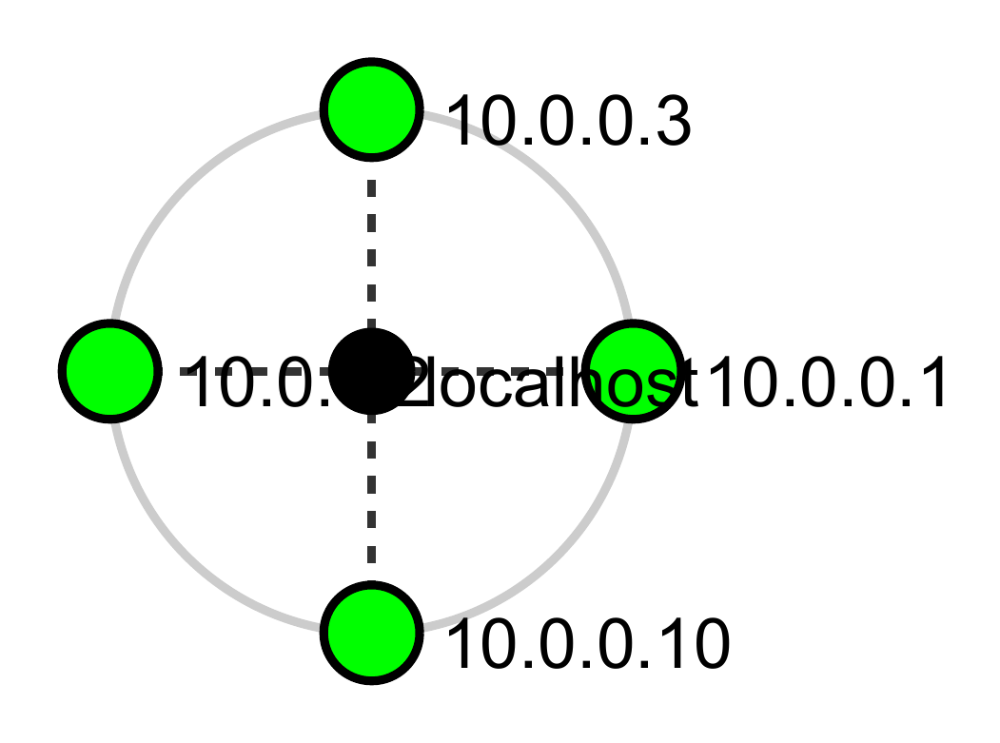

**Observation:** `10.0.0.1` and `10.0.0.3` report the same MAC. That is typical of QEMU's user-mode networking, where each emulated NIC uses the default `52:54:00:12:35:00` address, so it points to a virtual lab rather than a spoofing issue.

---

## Risk summary

These are **observations from information gathering**, not confirmed vulnerabilities. No exploitation was performed.

| # | Finding | Level |
|---|---|---|
| 1 | Unauthenticated camera streams discoverable via Google dorks (private devices) | 🔴 Critical |
| 2 | Web technology and versions exposed (WordPress, WP Download Manager, jQuery) | 🟠 Medium |
| 3 | DNS details exposed: BIND version banner, SPF `~all` soft-fail, DNSSEC unsigned | 🟠 Medium |
| 4 | Large sub-domain footprint including pre-prod/test names (9,481 host entries) | 🟠 Medium |
| 5 | Server IP resolvable, web and mail on the same address | 🟢 Low |
| 6 | HTTP headers reveal server and cache stack; cookie set without `Secure` flag on the HTTP hop | 🟢 Low |
| 7 | WAF identifiable as ModSecurity | 🟢 Low |
| 8 | WHOIS exposes registrar, dates and name servers (registrant privacy enabled) | 🟢 Low |
| 9 | Open directory listings indexed by Google (public math resources) | 🟢 Low |
| 10 | Four live hosts visible on the lab LAN (all virtual NICs) | 🟢 Low |

## Recommendations

1. **Limit what is public.** Hide or remove version strings (WordPress generator tag, plugin versions) and unneeded response headers.
2. **Patch consistently.** Keep the CMS, plugins and libraries current and watch their security advisories.
3. **Harden DNS.** Hide the BIND version, consider DNSSEC, and tighten SPF from `~all` to `-all` once all senders are listed.
4. **Review the sub-domain inventory.** Retire stale test, UAT and pre-prod hosts or restrict them to internal access.
5. **Secure cookies.** Set `Secure` (and `SameSite`) on cookies and enforce HSTS.
6. **Keep the WAF tuned.** ModSecurity is already blocking naive attempts; keep rules updated and monitored.
7. **Dork your own domain.** Run GHDB-style searches against your own assets and put authentication on any camera or admin interface.
8. **Scan your own network regularly** and investigate any device you do not recognise.
9. **Test only with written authorisation.**

## Repository structure

```
NETWORKWALKS-MUHAMMAD-ABDAL-KHAN-B084-WK2-PM-FOOTPRINTING-AND-NETWORK-SCANNING/
├── README.md                      ← this file
├── LINKEDIN_POST.md               ← caption options for sharing
├── Week2_Pentest_Report.pdf       ← full report
├── screenshots/
│   ├── pm1-01 … pm1-07            ← whois, whatweb, nslookup, curl, wafw00f, dnsrecon
│   ├── pm4-01 … pm4-05            ← theHarvester (Baidu and all sources)
│   └── pm5-01 … pm5-05            ← Zenmap install, ipconfig, ping scan, topology
└── evidence/
    ├── pm1-raw-tool-output.txt    ← raw text output of the six PM1 tools
    └── pm5-zenmap-topology.pdf    ← topology exported from Zenmap
```

